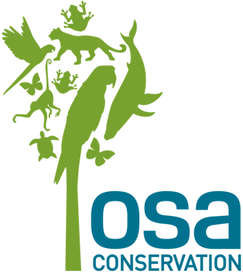
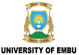
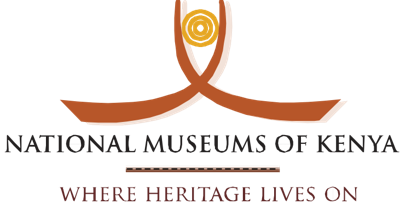
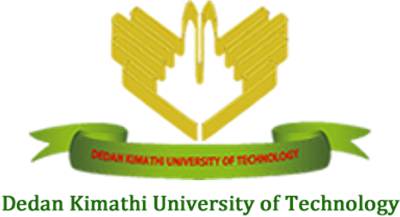
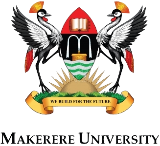
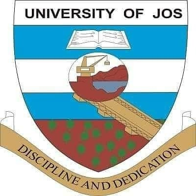
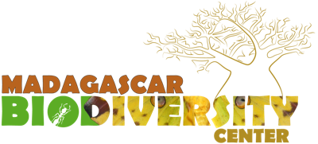
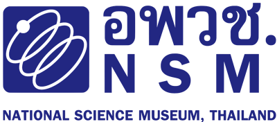
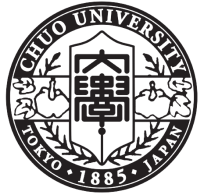
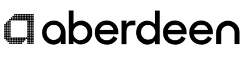

## Research and technology partners

- **UK Centre for Ecology & Hydrology (UKCEH)**: leads the work, and develops the AMI system and the AI.
- **The Alan Turing Institute**: AI, software and data infrastructure for AMBER.
- **Aarhus University** and **Mila – Quebec AI Institute**: AMI hardware and AI models.
- **British Trust for Ornithology (BTO)**: the bat Acoustic Pipeline.
- **De Vlinderstichting** (Dutch Butterfly Conservation), **Butterfly Conservation Europe**, **Aarhus University** and **Lund University**: AI for Europe's moths in [ADMIRE](../projects/admire/index.qmd).

```{=html}
<div class="logos">
  <figure></figure>
  <figure></figure>
</div>
```

## Deployment partners

The organisations running monitoring systems in their own countries, many through [AMBER](../projects/amber/index.qmd).

```{=html}
<div class="logos">
  <figure><figcaption>Osa Conservation · Costa Rica</figcaption></figure>
  <figure><figcaption>Organization for Tropical Studies · Costa Rica</figcaption></figure>
  <figure><figcaption>Smithsonian Tropical Research Institute · Panama</figcaption></figure>
  <figure><figcaption>University of Embu · Kenya</figcaption></figure>
  <figure><figcaption>National Museums of Kenya</figcaption></figure>
  <figure><figcaption>Tropical Biology Association · Kenya</figcaption></figure>
  <figure><figcaption>Dedan Kimathi University of Technology · Kenya</figcaption></figure>
  <figure><figcaption>Makerere University, Kampala · Uganda</figcaption></figure>
  <figure><figcaption>Perivoli Rangeland Institute · Namibia</figcaption></figure>
  <figure><figcaption>Jos Institute · Nigeria</figcaption></figure>
  <figure><figcaption>Madagascar Biodiversity Centre</figcaption></figure>
  <figure><figcaption>Nanyang Technological University · Singapore</figcaption></figure>
  <figure><figcaption>National Science Museum · Thailand</figcaption></figure>
  <figure><figcaption>Chuo University · Japan</figcaption></figure>
</div>
```

In Anguilla we work with the **Anguilla National Trust** ([the project](../projects/anguilla/index.qmd)).

## Funders

- **Aberdeen Group Charitable Trust**: [INSPIRE](../projects/inspire/index.qmd) (2026 to 2028).
- **abrdn Charitable Foundation**: [AMBER](../projects/amber/index.qmd).
- **European Commission (DG Environment)**: [ADMIRE](../projects/admire/index.qmd).
- **NERC and BBSRC**: [AgZero+](../projects/agzero/index.qmd).
- **UK Government Biodiversity Challenge Funds (Darwin Plus and Darwin Local)**: work in Anguilla.
- **UKCEH**: core funding.

```{=html}
<div class="logos">
  <figure></figure>
</div>
```
