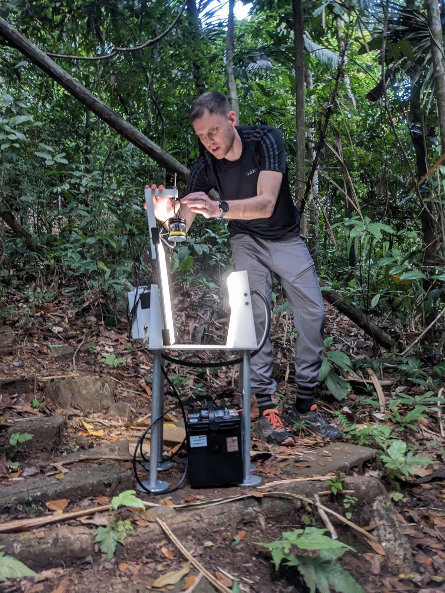
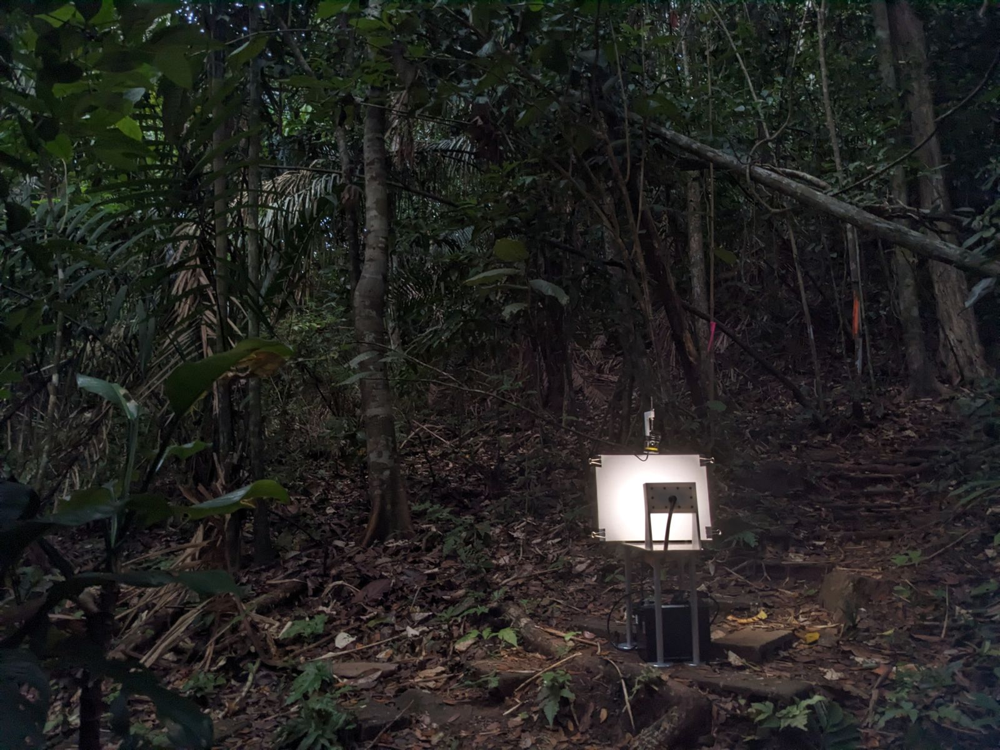
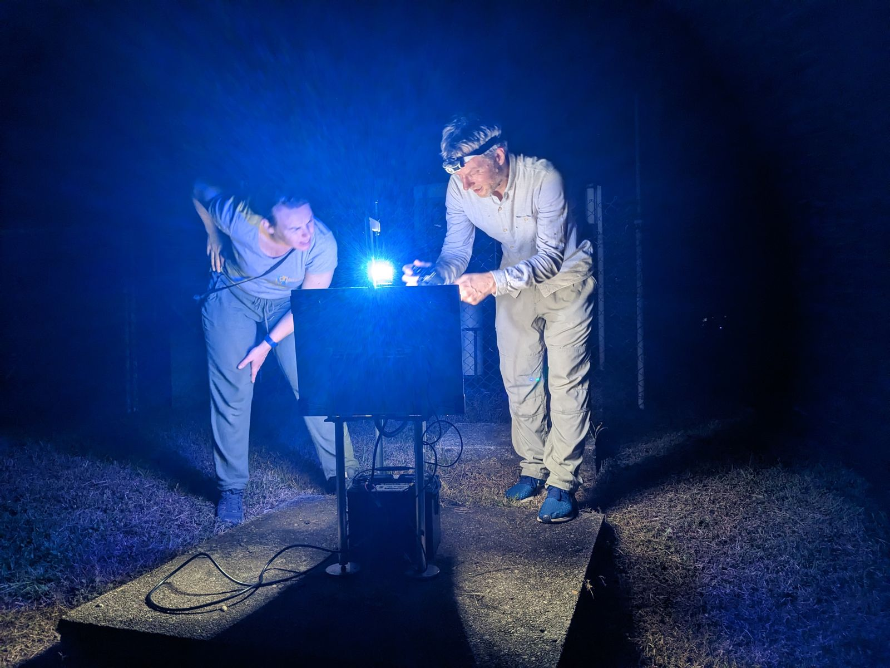
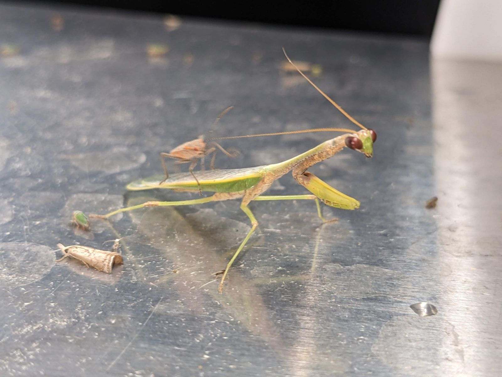
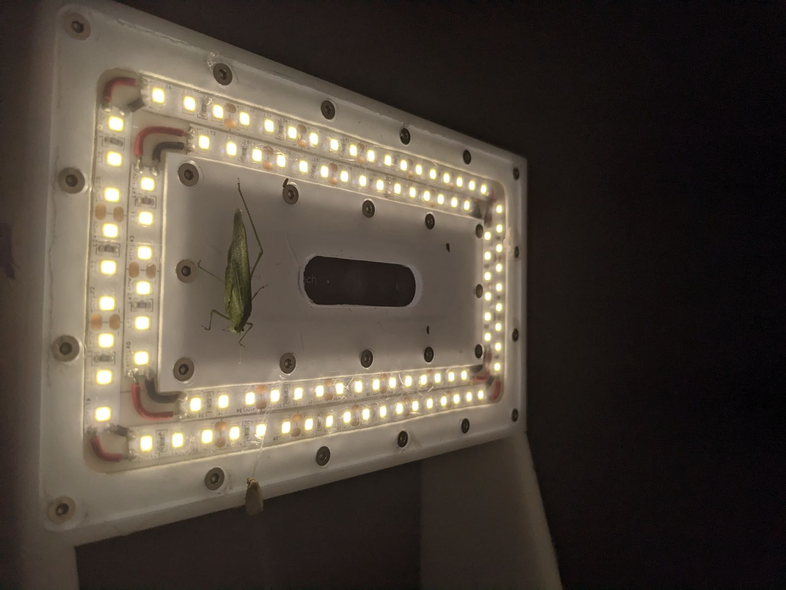
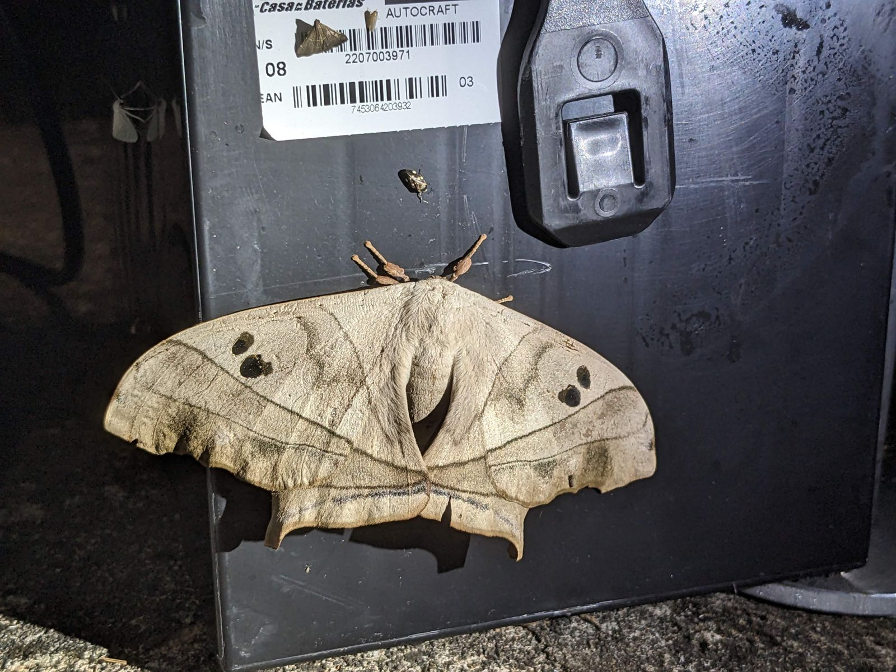
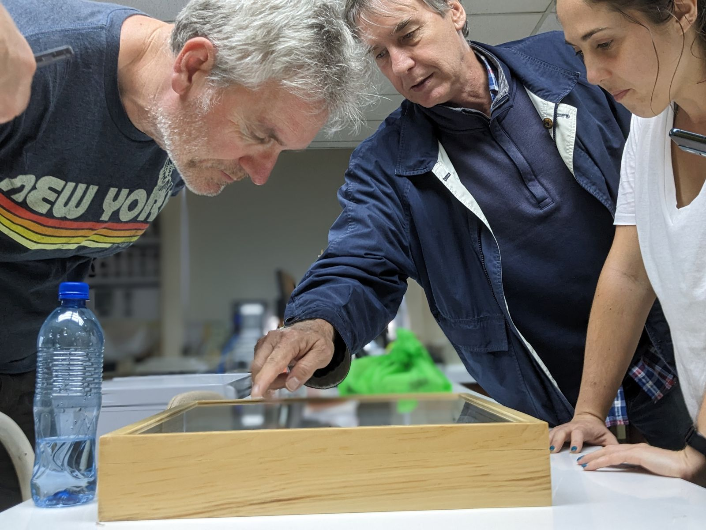

In January 2023 we spent a week in central Panama setting up AMI light traps in the rainforest with our partners there. Here are some of our favourite moments.

## Setting up

Each trap needs a spot that is dark, safe from falling branches and close enough to check. Under the forest canopy that takes some looking.

{fig-alt="A person setting up a white light trap on the forest floor"}

{fig-alt="A light trap standing in a rainforest"}

## When the lights come on

As the sun goes down, the trap's lights come on and the insects start to arrive. We checked the traps by torchlight to make sure everything was working, and to see who had turned up.

{fig-alt="Two people with head torches looking at a light trap at night"}

The visitors didn't disappoint: praying mantises hunting on the trap, katydids on the lights, and moths of every size, including some bigger than a hand.

::: {.gallery}

:::

## Days

By day we met our partners to plan the next steps, and looked at a research collection of pinned insects. Collections like this help experts check what the AI finds in the photos.

{fig-alt="People looking at a drawer of pinned insects"}

See [what our cameras see](../../index.qmd) and [where we work](../../map/index.qmd#panama).

*Photos: UKCEH.*
