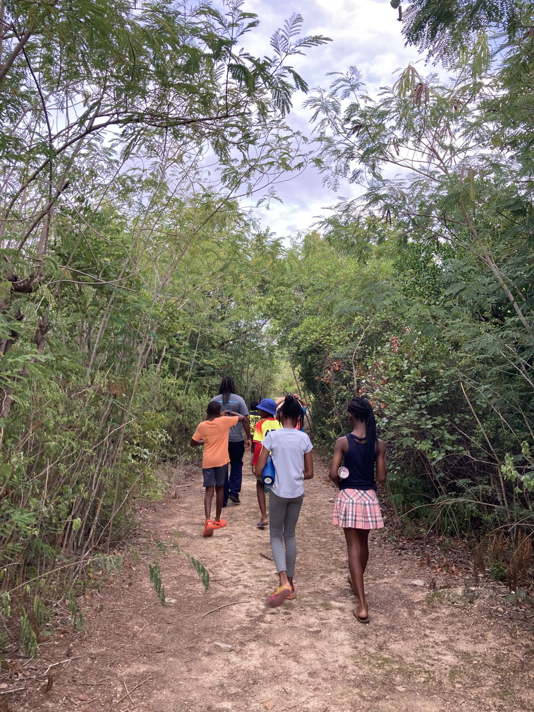
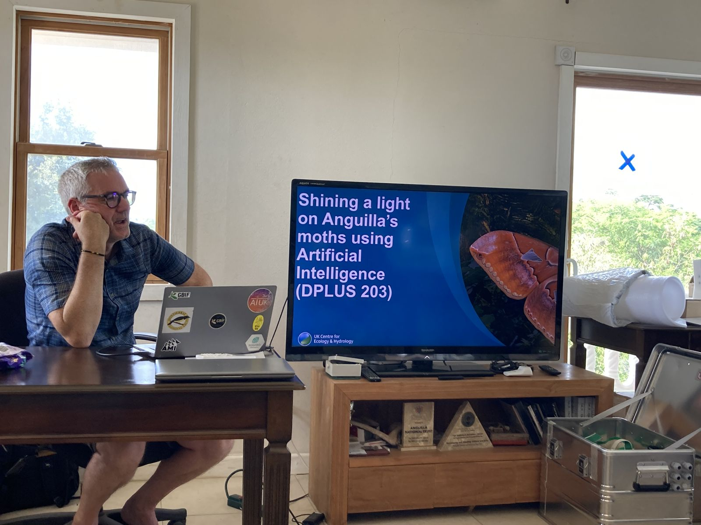
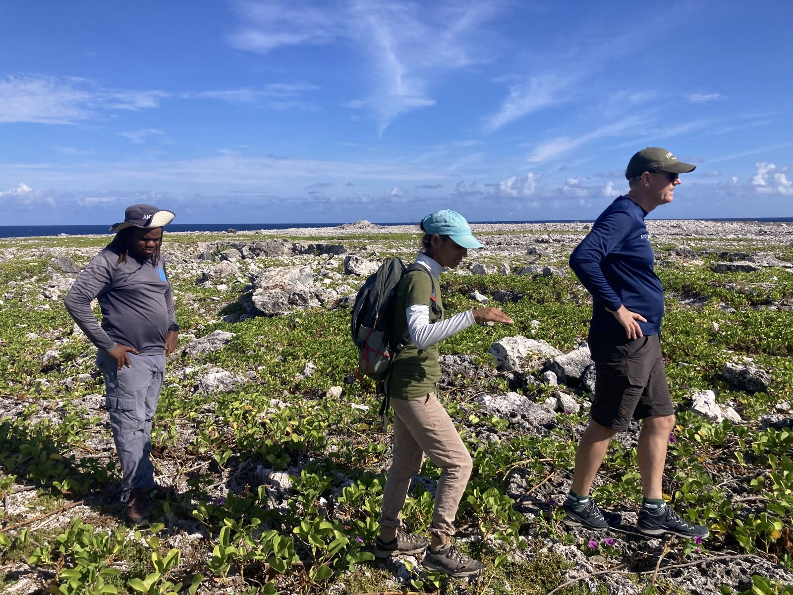
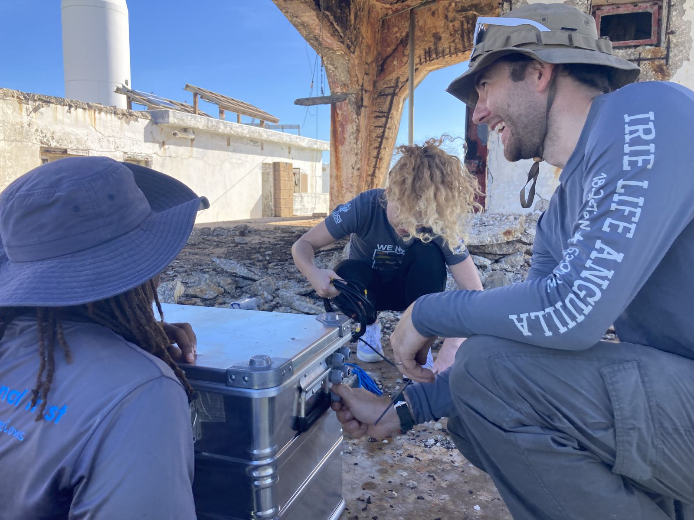
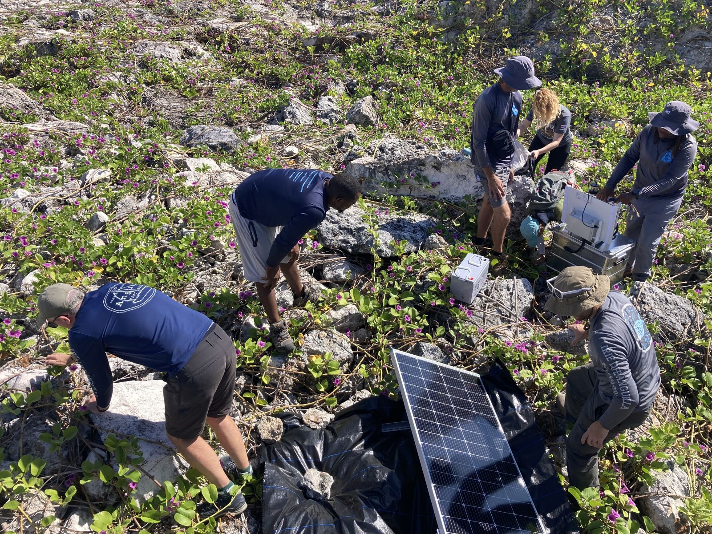
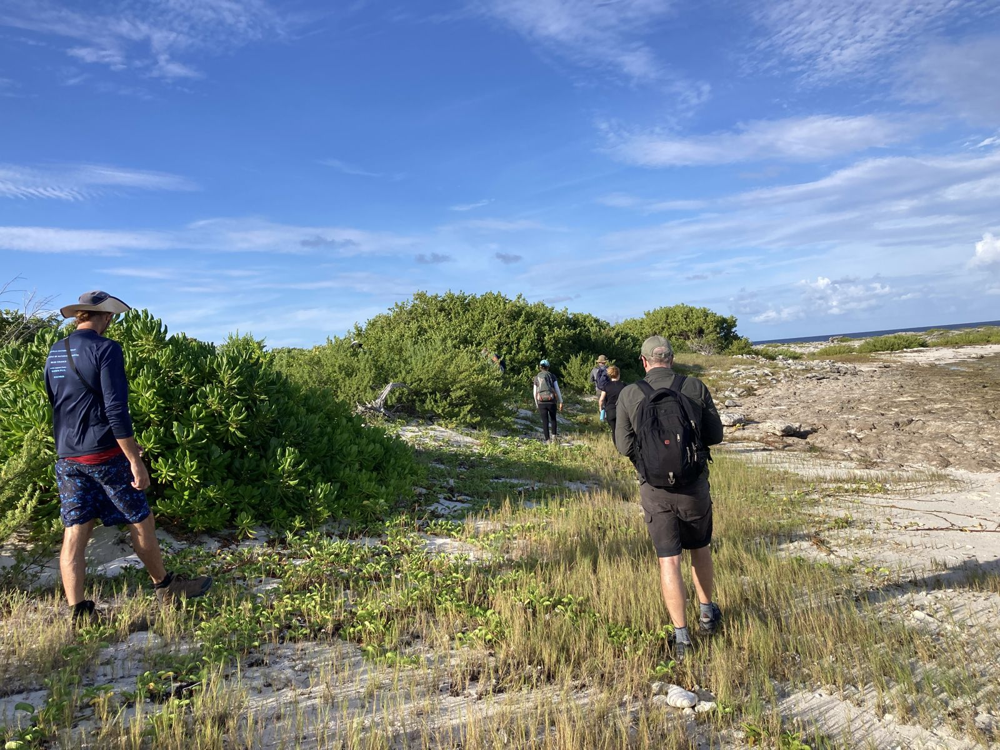
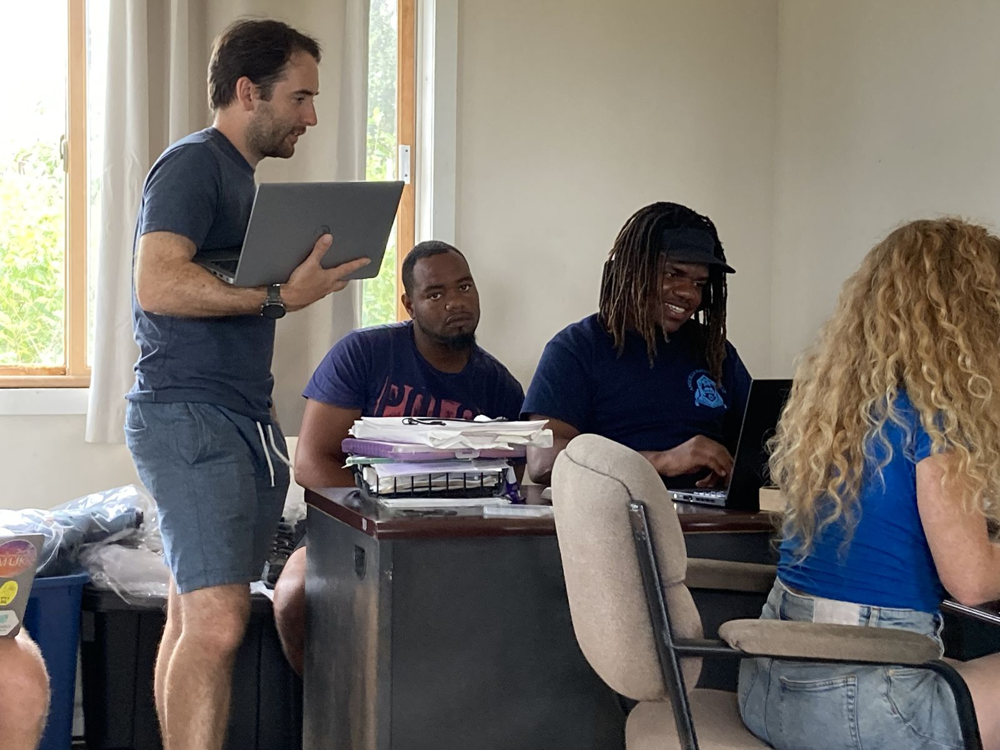

In late October 2024 the team travelled to Anguilla to set up the island's first automated light traps with the Anguilla National Trust. It was a busy week.

## Getting to know the island

We started outdoors, on nature walks with the Trust, and spent time on the coast looking at the habitats where the traps might go.

{fig-alt="A group walking along a path through dry forest"}

## Learning together

Back indoors, we ran sessions on how the traps work and what happens to the photos they take: how AI finds the insects, and how experts check what it says. Later in the week we sat down with the Trust's team at their laptops to work through the data together.

{fig-alt="People in a room with a presentation on a screen"}

## Out to the islands

The highlight was taking traps out to Anguilla's small offshore islands. Everything has to be carried in by hand: the trap, its battery and the solar panel that keeps it running for months. The ground is sharp rock and low scrub, with no shade and plenty of wind.

{fig-alt="Three people standing on rocky ground covered in low plants"}

::: {.gallery}

:::

By the end of the week the traps were photographing Anguilla's night-flying insects every night. See what happened next in [Anguilla's first AMI season](../../news/2025-01-15-anguilla-first-ami-season/index.md) and the [Anguilla project](../../projects/anguilla/index.qmd).

*This work is funded by the UK Government's Darwin Plus programme.*
