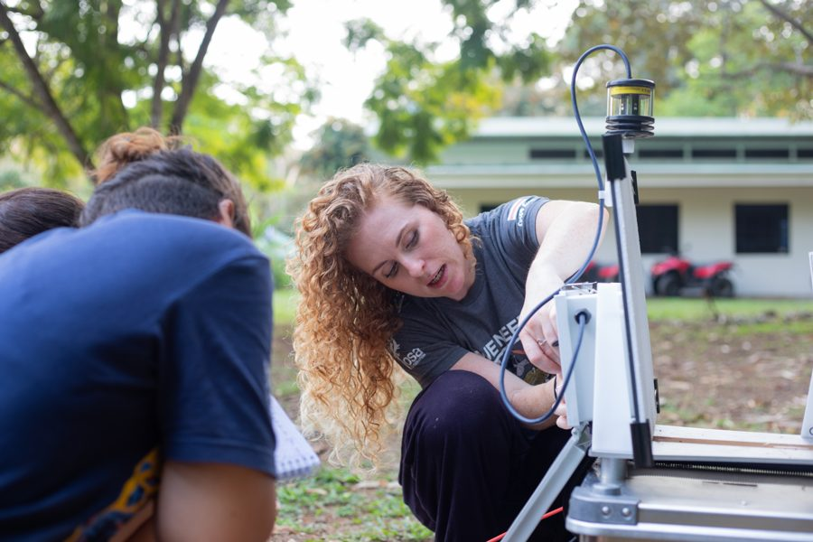

{width=220px fig-align="right" fig-alt="Dr Jenna Lawson explaining how an AMI device is set up"}

Join Dr Jenna Lawson, our Ecological Network Coordinator, as she works in the Costa Rican wilderness to deploy the AMBER systems on site.

::: {.video-grid}
```{=html}
<figure><iframe src="https://drive.google.com/file/d/1W93CSZIreNUFvB71IcA-xDJh2h_ymhko/preview" loading="lazy" allow="autoplay" allowfullscreen title="Meet Jenna"></iframe>
<figcaption><strong>1. 👋 Meet Jenna</strong>An introduction to our Ecological Network Coordinator.</figcaption></figure>

<figure><iframe src="https://drive.google.com/file/d/12uc4gpzfEKOhoAZLtt7C0gGht1k_FNlG/preview" loading="lazy" allow="autoplay" allowfullscreen title="Debugging and testing"></iframe>
<figcaption><strong>2. 🔧 Debugging and testing</strong>Troubleshooting the AMI systems in the lab before they go out to the field.</figcaption></figure>

<figure><iframe src="https://drive.google.com/file/d/1_Zh_xfu23iRa_HiFrFlqeDFSxoNJKKmd/preview" loading="lazy" allow="autoplay" allowfullscreen title="La Selva Station"></iframe>
<figcaption><strong>3. 🌳 La Selva Station</strong>Arriving at Costa Rica's research hub in the old-growth forest.</figcaption></figure>

<figure><iframe src="https://www.youtube-nocookie.com/embed/e5_BV_tp7tg" loading="lazy" allowfullscreen title="Bullet ant encounter"></iframe>
<figcaption><strong>4. 🐜 Bullet ant encounter</strong>What happens when wildlife investigates our equipment.</figcaption></figure>

<figure><iframe src="https://drive.google.com/file/d/1UDBLCyd_RcbwIwtbLFdx1oJoxx4QaJHe/preview" loading="lazy" allow="autoplay" allowfullscreen title="Night system check"></iframe>
<figcaption><strong>5. 🌙 Night system check</strong>Making sure the night-time monitoring works in the field.</figcaption></figure>
```
:::

**More from Costa Rica:** [the project](../../projects/costa-rica/index.qmd) · [big beautiful moths](../../stories/2025-09-05-amber-big-beautiful-moths/index.md)
