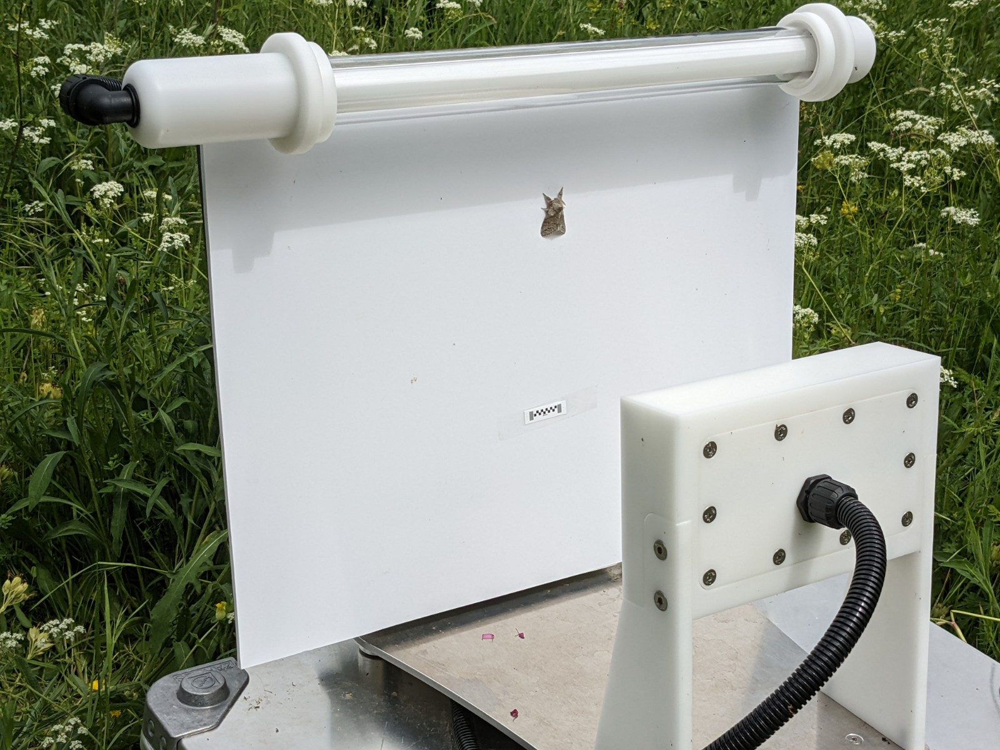

```{=html}
<div class="hero">
  
  <div class="hero-text">
    <h1>Watching wildlife, automatically</h1>
    <p>We build and use light traps, sound recorders and bat detectors that work on their own, day and night, and the AI that turns millions of photos and recordings into wildlife records. We work with partners around the world to understand and protect biodiversity.</p>
    <div>
      <a class="btn btn-warning btn-lg" href="technology/index.html">Our technology</a>
      <a class="btn btn-light btn-lg" href="how-to/index.html">How-to guides</a>
    </div>
  </div>
</div>
```

::: {.content-block}

## What we do

::: {.card-grid}
```{=html}
<a class="tile" href="technology/ami.html"><span class="tag">Light traps for moths</span><h3>AMI and LepiSense</h3><p>Cameras and lights that photograph night-flying insects, all night, every night.</p></a>
```

```{=html}
<a class="tile" href="technology/acoustics.html"><span class="tag">Sound</span><h3>Sound recorders</h3><p>Small recorders that capture birdsong and the soundscape for weeks at a time.</p></a>
```

```{=html}
<a class="tile" href="technology/ultrasonic.html"><span class="tag">Ultrasound</span><h3>Bat detectors</h3><p>Recorders that pick up bats' echolocation calls, far above human hearing.</p></a>
```

```{=html}
<a class="tile" href="stories/2025-09-05-amber-machine-learning/index.html"><span class="tag">AI and experts</span><h3>From data to wildlife records</h3><p>Machine learning finds and names the animals; experts check the results.</p></a>
```
:::

## Latest stories, news and diaries

:::{#latest}
:::

[All stories](stories/index.qmd){.btn .btn-outline-primary} [News](news/index.qmd){.btn .btn-outline-primary} [Fieldwork diaries](diaries/index.qmd){.btn .btn-outline-primary}

## Where we work

Our partners run monitoring systems across ten countries, from UK farms and woodlands to tropical forests in Costa Rica, Panama, Singapore and Thailand.

[See the map](map/index.qmd){.btn .btn-primary}

## Working with us?

::: {.card-grid}
```{=html}
<a class="tile" href="how-to/upload.html"><span class="tag">Partners</span><h3>Send us your data</h3><p>Step-by-step help to upload your photos or recordings, with no programming needed.</p></a>
```

```{=html}
<a class="tile" href="https://github.com/NERC-CEH/ceh-biomonitoring" target="_blank" rel="noopener"><span class="tag">Researchers</span><h3>Use our tools</h3><p>Our open-source toolkit runs the same AI models on your own data, in Python or R.</p></a>
```
:::

:::
