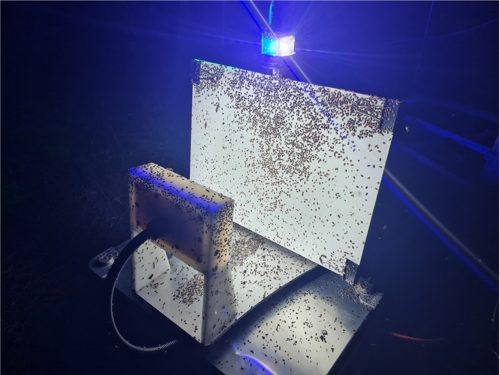
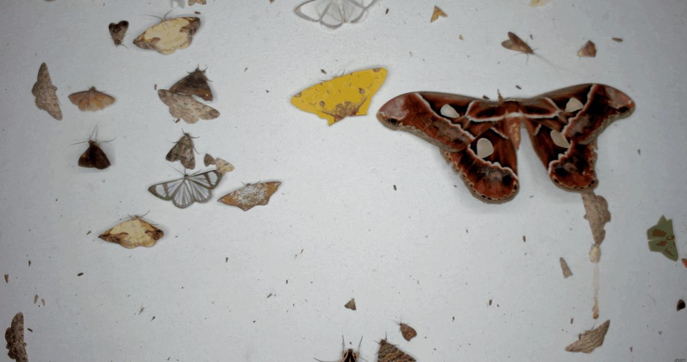
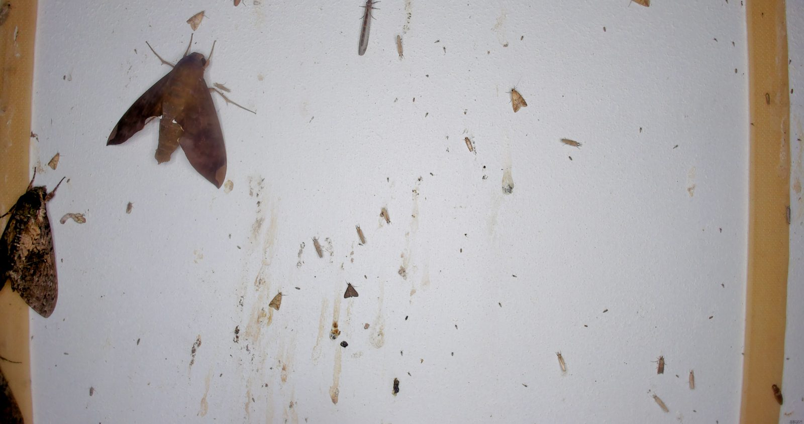
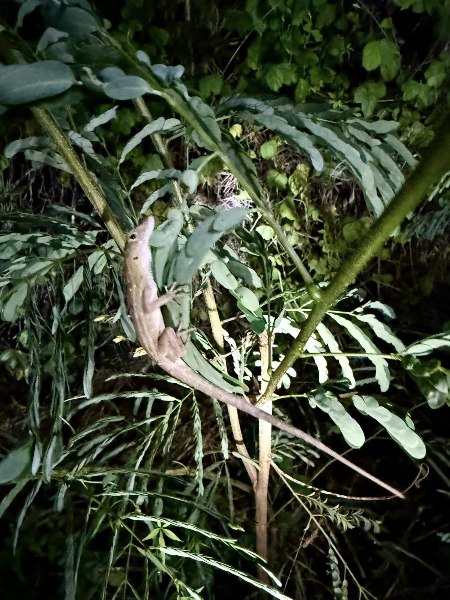
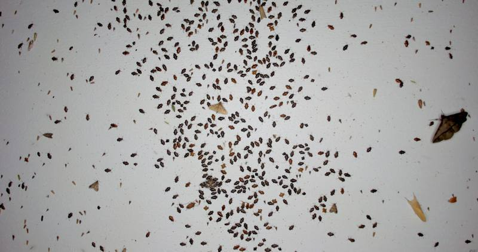
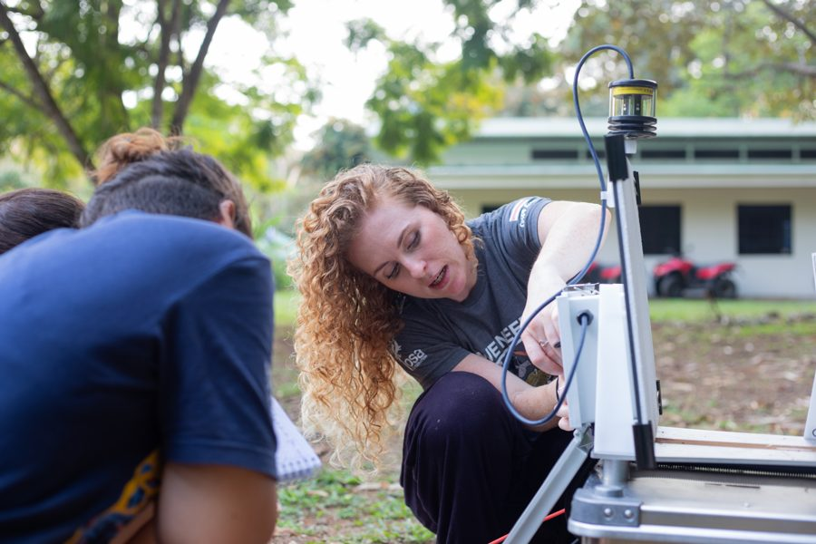
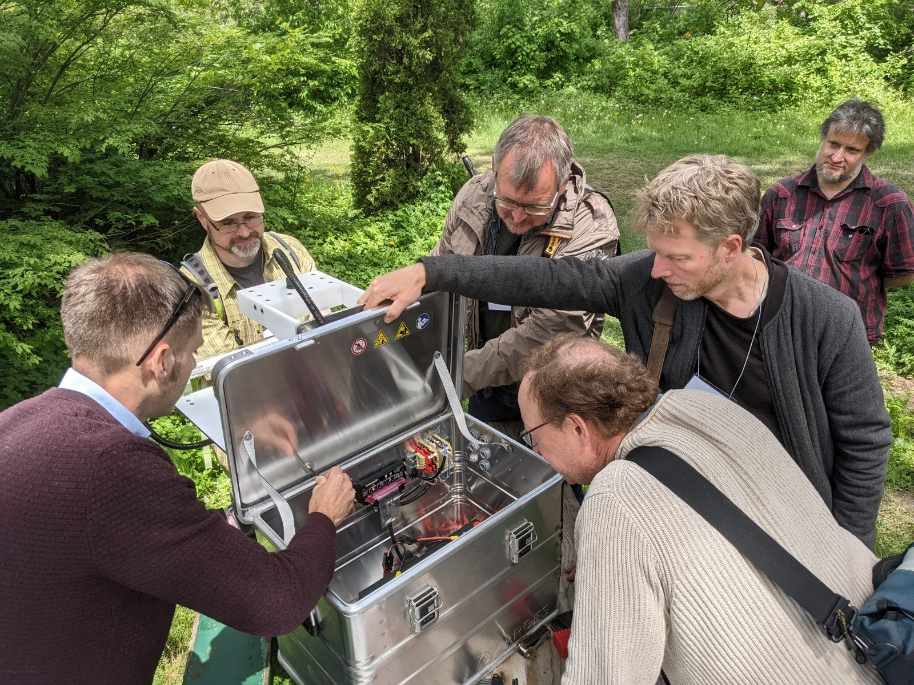
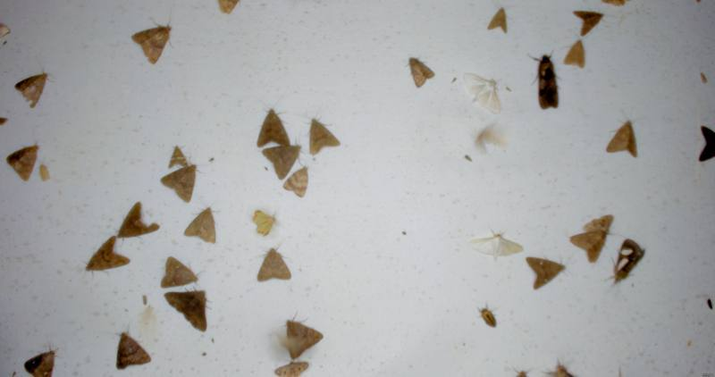
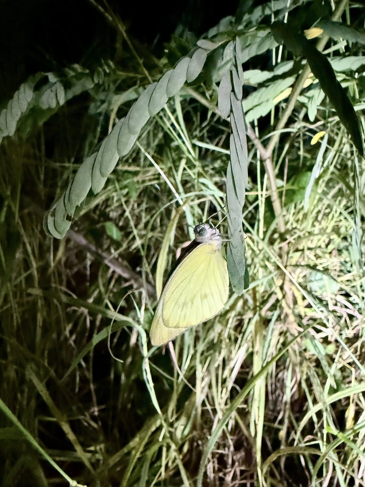
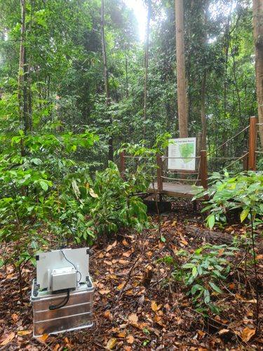

<!-- The home page is for everyone, so it starts with pictures and stories; the technical pages
     (technology, how-to guides, the toolkit) are at the bottom. -->

```{=html}
<div class="hero night">
  
  <div class="hero-text">
    <span class="kicker">Nature never sleeps</span>
    <h1>Neither do our cameras</h1>
    <p>We watch wildlife night and day with cameras, microphones and AI, from UK farms to tropical forests, and share what we find with the people who protect it.</p>
    <div>
      <a class="btn btn-warning btn-lg" href="stories/index.html">Read our stories</a>
      <a class="btn btn-light btn-lg" href="map/index.html">Where we work</a>
    </div>
  </div>
</div>

<div class="big-numbers" id="home-numbers" aria-label="Our systems in numbers">
  <div><strong>11</strong>countries</div>
  <div><strong>149</strong>systems in the field</div>
  <div><strong>16 million</strong>photos of wildlife</div>
  <div><strong>51 million+</strong>insects spotted by our AI</div>  <!-- detections (crops) from the 22 AMBER deployments processed so far (AMBER wrap-up, deployments_summary.csv); more are still being processed -->
</div>
```

::: {.content-block}

## Latest from the field

::: {.section-intro}
Stories, news and diaries from our team and our partners around the world.
:::

:::{#latest}
:::

[All stories and news](stories/index.qmd){.btn .btn-dark}

## What our cameras see

::: {.section-intro}
Our light traps photograph every insect that lands on them, all night. Here are a few of our favourites.
:::

```{=html}
<div class="mosaic">
  <a class="big" href="stories/2025-09-05-amber-big-beautiful-moths/index.html"><span>Big, beautiful moths</span></a>
  <a href="projects/anguilla/index.html"><span>Moths new to Anguilla</span></a>
  <a href="news/2025-11-25-anguilla-night-hike/index.html"><span>Night walks in Anguilla</span></a>
  <a class="wide" href="map/index.html#costa-rica"><span>One night on the screen in Costa Rica</span></a>
  <a href="diaries/2025-09-05-costa-rica-fieldwork/index.html"><span>Fieldwork in Costa Rica</span></a>
  <a href="projects/amber/index.html"><span>Working with partners</span></a>
  <a href="map/index.html#nigeria"><span>A busy night in Nigeria</span></a>
  <a href="stories/2025-09-05-amber-wildlife-encounters/index.html"><span>Wildlife encounters</span></a>
</div>
```

## Our projects

::: {.section-intro}
We work with partners who know their places best, from island trusts to universities.
:::

:::{#home-projects}
:::

[All projects](projects/index.qmd){.btn .btn-dark}

```{=html}
<div class="band">
  <div>
    <h2>Where we work</h2>
    <p>Our systems have run in 11 countries, on farms, in woodlands, on islands and in rainforests. Explore the map to see a few nights from each.</p>
    <p class="chips"><span>United Kingdom</span><span>Costa Rica</span><span>Panama</span><span>Anguilla</span><span>Kenya</span><span>Nigeria</span><span>Namibia</span><span>Cyprus</span><span>Thailand</span><span>Singapore</span><span>Japan</span></p>
    <p><a class="btn btn-warning btn-lg" href="map/index.html">Explore the map</a></p>
  </div>
  
</div>
```

## About us

We're a team at the [UK Centre for Ecology & Hydrology](https://www.ceh.ac.uk) who bring ecologists, engineers and data scientists together to find new ways of watching wildlife. [Meet us and our partners](about/index.qmd).

::: {.tech-zone}

## For partners and researchers

The technical side: the devices we use, step-by-step guides, and our free software.

::: {.route-grid}
```{=html}
<a class="route" href="how-to/do-it-yourself.html"><span class="tag">On your own</span><h3>Do it yourself</h3><p>Run your own survey with our free tools: we point you to the right guide for each step.</p><span class="route-go">Start here →</span></a>
<a class="route route-dark" href="how-to/working-with-ukceh.html"><span class="tag">With us</span><h3>Working with UKCEH</h3><p>We advise on devices, process your data and give you the results.</p><span class="route-go">How it works →</span></a>
```
:::

::: {.card-grid}
```{=html}
<a class="tile" href="technology/ami.html"><span class="tag">Light traps</span><h3>AMI and LepiSense</h3><p>Cameras and lights that photograph night-flying insects.</p></a>
<a class="tile" href="technology/acoustics.html"><span class="tag">Sound</span><h3>Sound recorders</h3><p>Recorders for birdsong and soundscapes.</p></a>
<a class="tile" href="technology/ultrasonic.html"><span class="tag">Ultrasound</span><h3>Bat detectors</h3><p>Recorders for bats' echolocation calls.</p></a>
<a class="tile" href="https://github.com/NERC-CEH/ceh-biomonitoring" target="_blank" rel="noopener"><span class="tag">Software</span><h3>Our toolkit</h3><p>Free, open-source AI for photos and recordings, in Python or R.</p></a>
```
:::

:::

:::

```{=html}
<script>
// Keep the big numbers in step with the map.
fetch("map/deployments.json").then(r => r.json()).then(d => {
  const sys = d.countries.reduce((n, c) => n + c.systems, 0), img = d.countries.reduce((n, c) => n + c.images, 0);
  const b = document.querySelectorAll("#home-numbers strong");
  b[0].textContent = d.countries.length; b[1].textContent = sys; b[2].textContent = Math.floor(img / 1e6) + " million";
}).catch(() => {});
</script>
```
