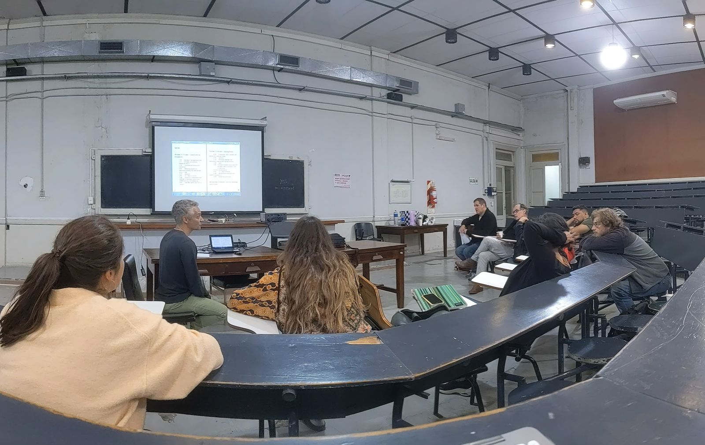
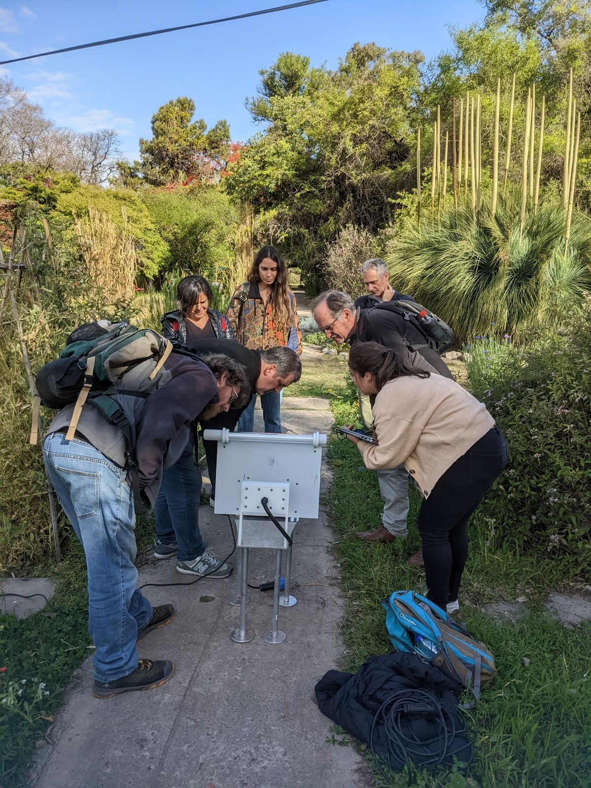
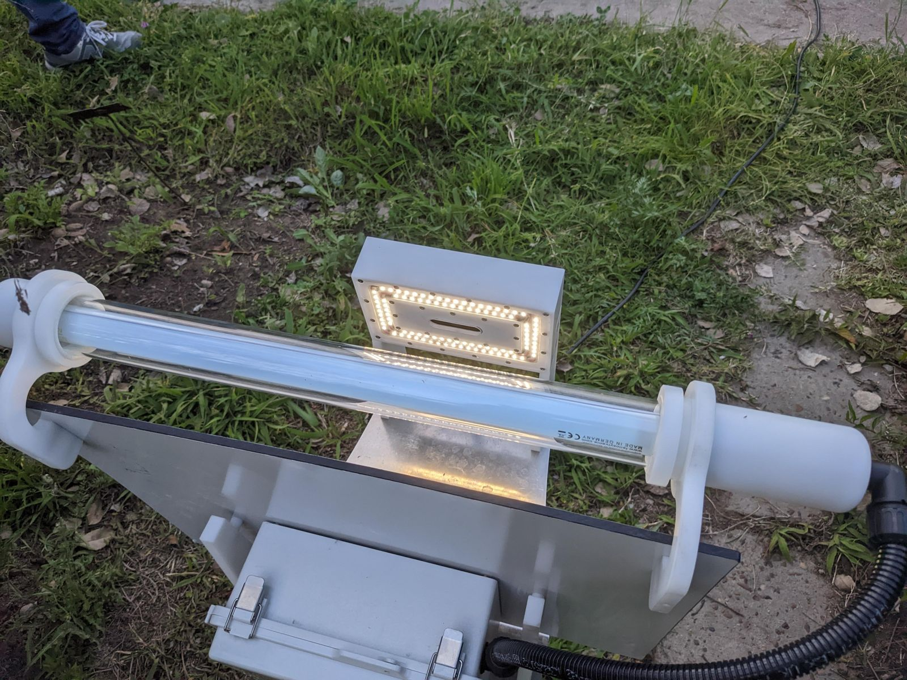
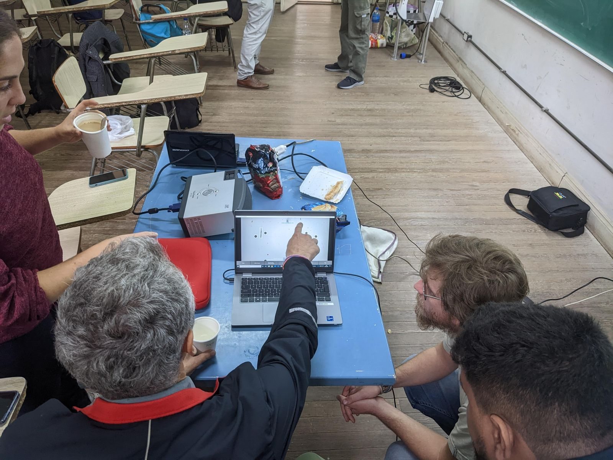

In October 2022 we were in Buenos Aires for a two-day workshop on automated monitoring of insects with Argentinian partners, part of the Argentina–UK collaboration [SABIOMA](https://www.ceh.ac.uk/solutions/equipment/automated-monitoring-insects-trap).

{fig-alt="A lecture room with people at desks and a presentation on a screen"}

## From talks to hands-on

After talks on how the traps and the AI work, everyone went outside to set up an AMI light trap together and see it come on at dusk. The next day we worked through the software on laptops: how to get photos off a trap and what the AI makes of them.

::: {.gallery}

:::

Thank you to everyone who came. More about the [AMI light trap](../../technology/ami.qmd).
