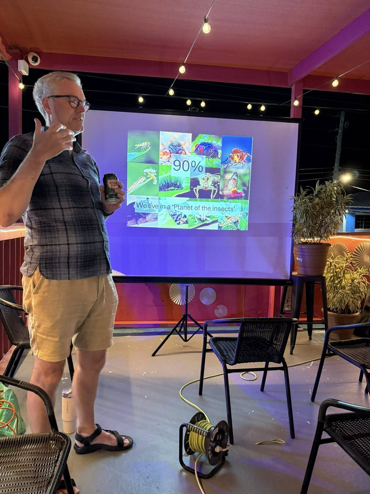
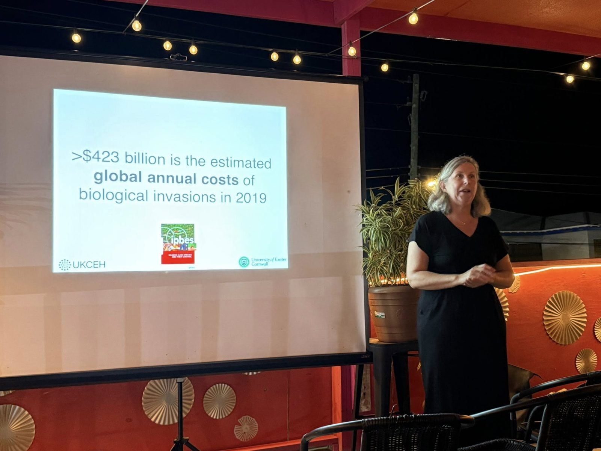
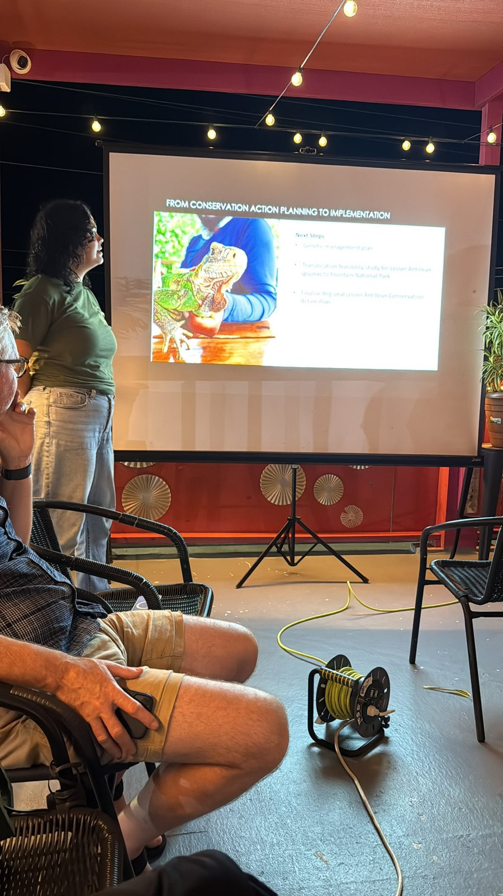
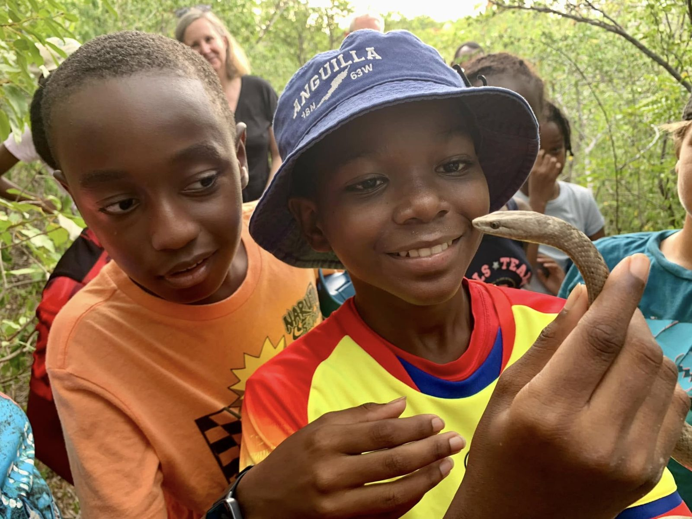
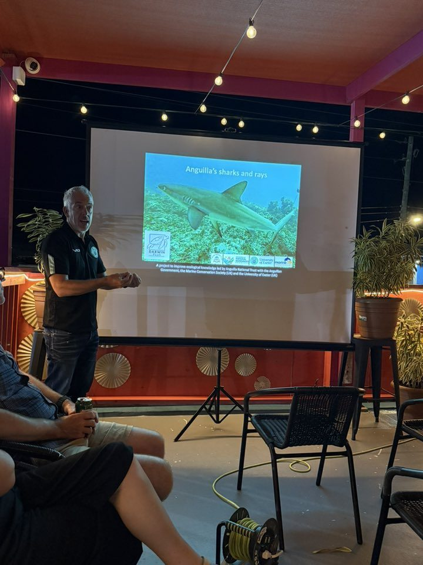

**Anguilla National Trust Nature Week** ended with a series of talks on research to better understand and protect Anguilla's extraordinary biodiversity. Speakers shared updates on work with some of the island's most remarkable species, from endangered reptiles to understudied moths and insects, and even the often-misunderstood sharks in its waters.

The Anguilla National Trust thanked everyone who took part, and the partners whose expertise made the week possible: Dr David Roy and Dr Helen Roy of the UK Centre for Ecology & Hydrology, and Dr Matthew Witt of the University of Exeter. Special thanks also went to the UK Government's Biodiversity Challenge Funds (Darwin Plus) and Fauna & Flora's Conservation Leadership Programme for their support.

::: {.gallery}

:::

See also the [night hike](../2025-11-25-anguilla-night-hike/index.md) and the [Anguilla project](../../projects/anguilla/index.qmd).
