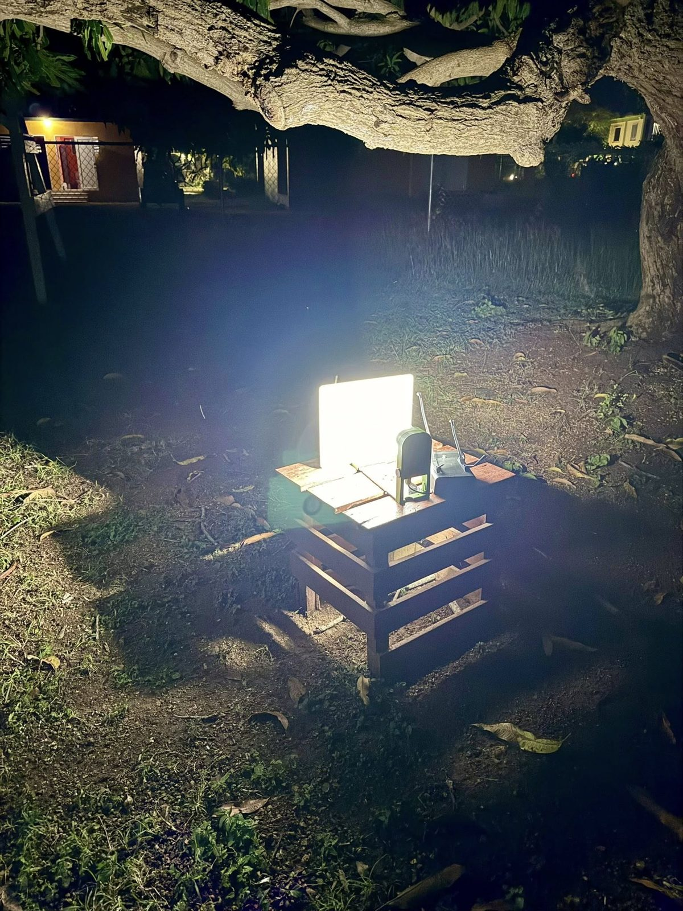
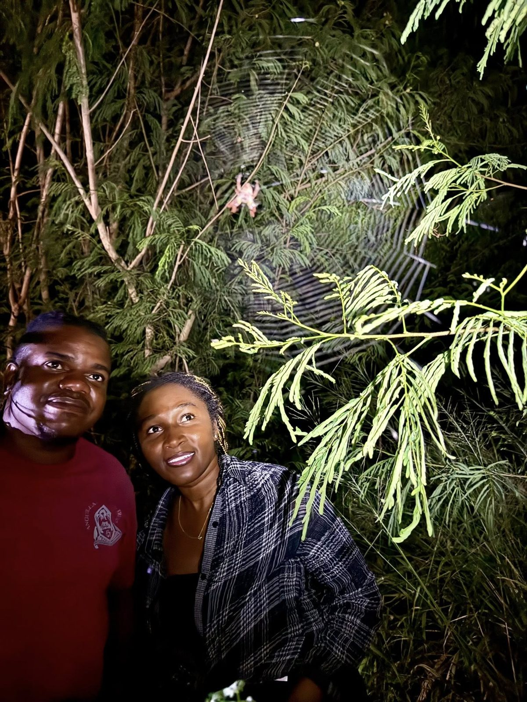
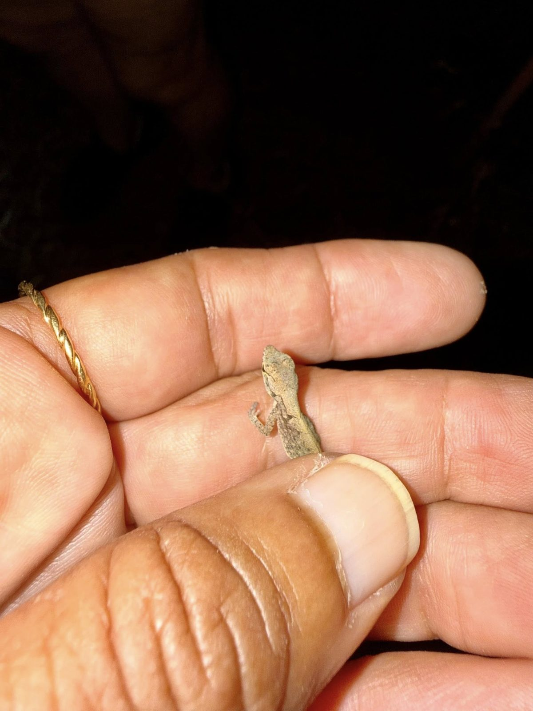
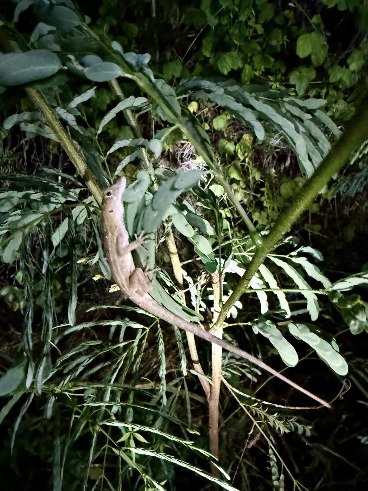
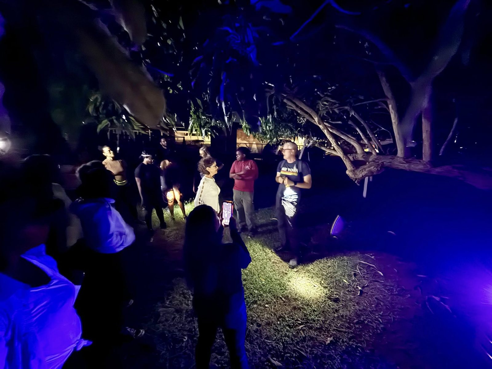
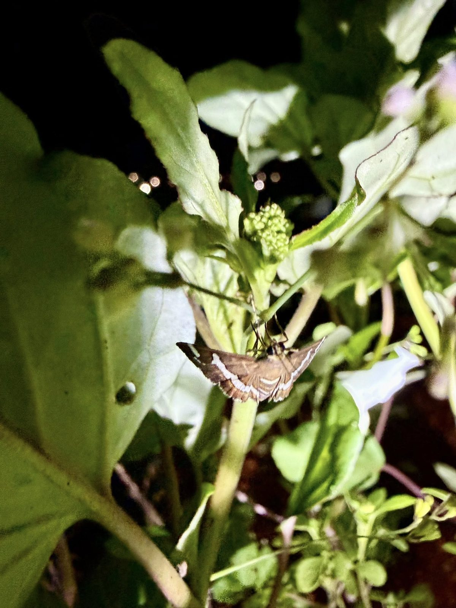
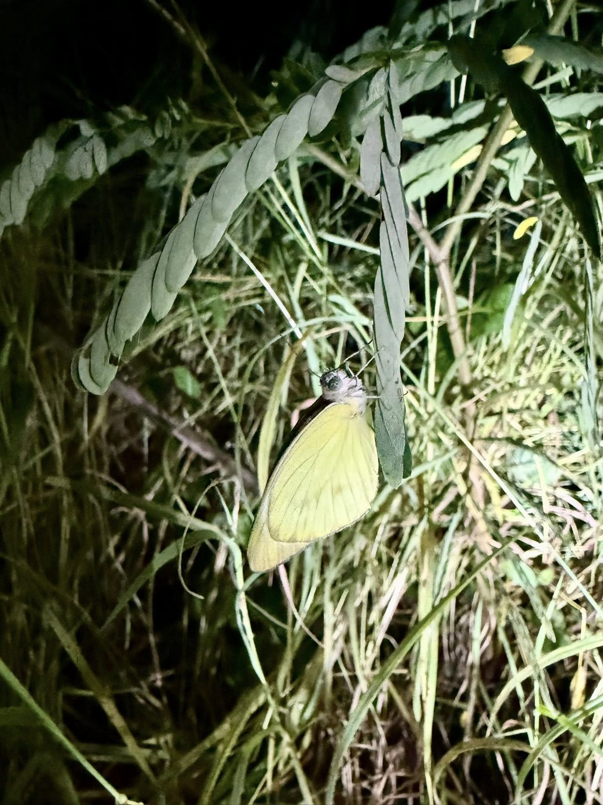
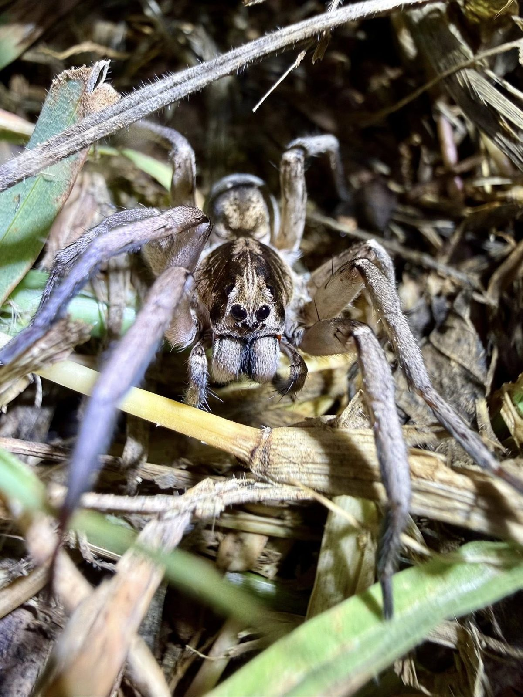
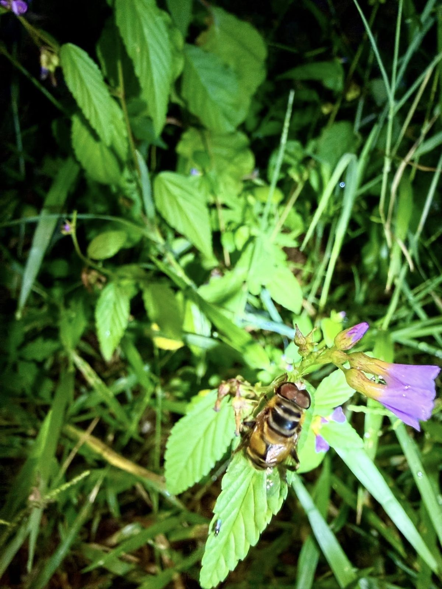

**Anguilla National Trust Nature Week** brought the island's unique wildlife and conservation work into sharp focus, beginning with a guided night hike through the agricultural lands of The Valley.

Participants set out after dark in search of nocturnal wildlife, discovering the **"night critters"** that often go unseen but play vital roles in the island's ecosystems. The walk offered residents and visitors a rare chance to experience Anguilla's natural world from a new perspective.

The week blended exploration, science and community engagement, celebrating both curiosity and conservation. The organisers thanked everyone who took part, and the partners whose expertise made the week possible: Dr David Roy and Dr Helen Roy of the UK Centre for Ecology & Hydrology, and Dr Matthew Witt of the University of Exeter. Special thanks also went to the UK Government's Biodiversity Challenge Funds (Darwin Plus) and Fauna & Flora's Conservation Leadership Programme for their support.

Nature Week once again showed the importance of local and international partnerships in safeguarding Anguilla's natural heritage, and the enthusiasm of a community eager to learn about, explore and protect the island's wild places.

## Gallery

::: {.gallery}

:::

Click a photo to see it full size. More in [Nature Week talks](../2025-11-25-anguilla-nature-week-talks/index.md).
