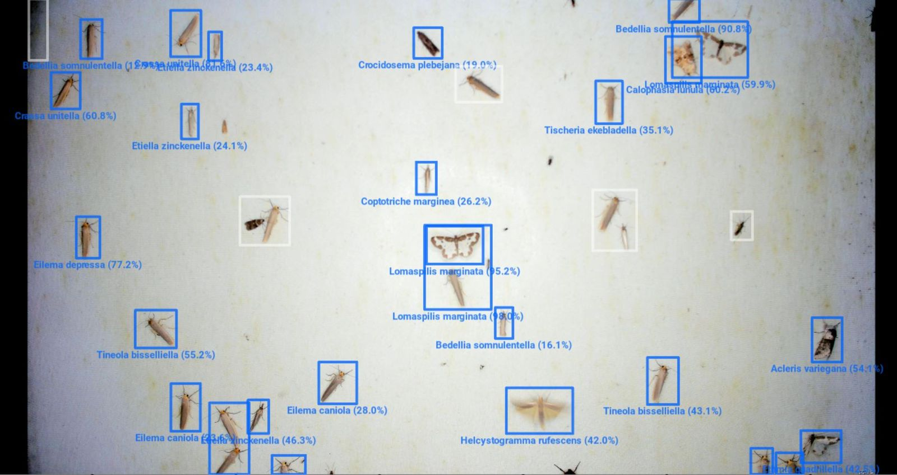

{fig-alt="A light-trap photo with boxes and names drawn round each insect"}

::: {.at-a-glance}
**Status:** ongoing, since October 2026 · **Where:** Europe · **Funder:** the European Commission (DG Environment)

**Partners:** De Vlinderstichting (Dutch Butterfly Conservation, lead), Butterfly Conservation Europe, Aarhus University, Lund University and the UK Centre for Ecology & Hydrology
:::

## Overview

Moths are one of the best ways to tell how nature is doing, and light traps with cameras could make moth monitoring possible across the whole of Europe. **ADMIRE** brings together moth experts and AI researchers to help make that happen, for the European Commission.

## Our part

UKCEH is looking at how well today's AI models can identify Europe's moths:

- **How good are the models?** Testing how accurately the latest open models name each species.
- **Where are the gaps?** Finding which species have too few good photos to train AI on, using the millions of moth images shared through [GBIF](https://www.gbif.org).
- **What next?** Exploring how photos from automated light traps could add to these image collections and make the models better.

The results will help plan how AI can support moth monitoring across Europe.
