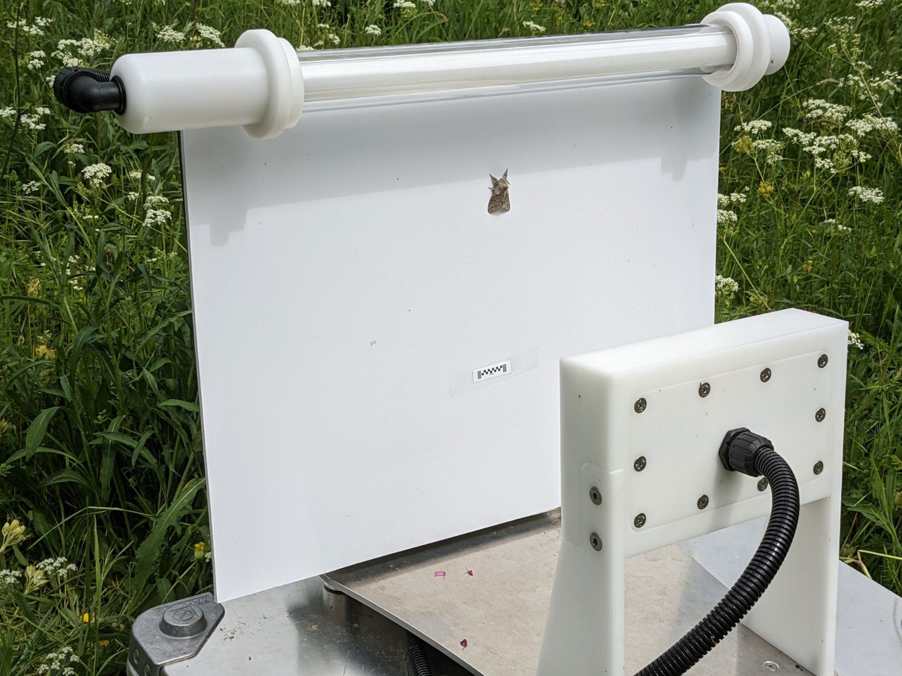

{fig-alt="A white automated moth trap standing in long grass"}

::: {.at-a-glance}
**Status:** ongoing · **Where:** farms and peatlands across England · **Technology:** [AMI light traps](../../technology/ami.qmd), [sound recorders](../../technology/acoustics.qmd) and AI

**Partners:** led by the UK Centre for Ecology & Hydrology, with Rothamsted Research, the British Geological Survey, Plymouth Marine Laboratory and the National Centre for Earth Observation. Funded by the Natural Environment Research Council (NERC) and the Biotechnology and Biological Sciences Research Council (BBSRC).
:::

## Overview

**AgZero+** is a five-year research programme, led by UKCEH, that supports the UK's move towards growing food in a way that is sustainable, carbon-neutral and good for nature. It works with a network of study farms, and brings together farm data, modelling and new ways of monitoring.

## Watching wildlife on farms

Do wildflower strips, hay meadows, agroforestry and rewetted peat really help wildlife? To find out, UKCEH puts solar-powered monitoring stations on farms:

- **Light traps with cameras** photograph moths and other night-flying insects.
- **Sound recorders** pick up birds, bats and other animals.
- **AI** identifies the species in the photos and recordings.

This work is ongoing. It started in 2023 at four pairs of farms, in Dorset, Wiltshire, Oxfordshire and Northamptonshire, comparing land with and without agri-environment schemes, and at two peatland sites in Cambridgeshire, one farmed and one being restored. Each year the stations move to new sites across England, and run from March to October.

## Tools for farmers

AgZero+ also develops free tools, such as **E-Planner**, which helps farmers find the best places on their land for trees, pollinator habitat, river protection and wild-bird food.

## Find out more

- [AgZero+ on the UKCEH website](https://www.ceh.ac.uk/our-science/projects/agzero)
- [AI enables scientists to monitor impact of farming on biodiversity](https://www.ceh.ac.uk/press/ai-enables-scientists-monitor-impact-farming-biodiversity) (UKCEH press release, July 2023)
- [Where we work](../../map/index.qmd), including our systems in the UK
