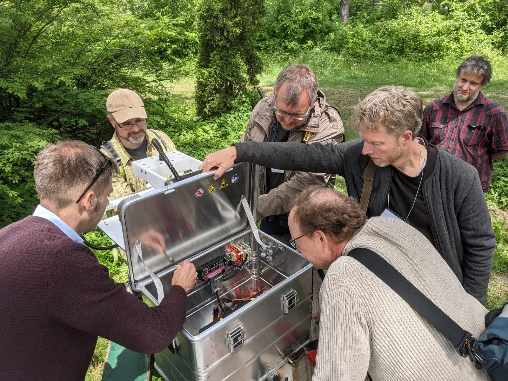

{fig-alt="An AMBER monitoring system in the field"}

::: {.at-a-glance}
**Status:** completed pilot · **Region:** global · **Technology:** [AMI light traps](../../technology/ami.qmd), [sound recorders](../../technology/acoustics.qmd)

**Partners:** UK Centre for Ecology & Hydrology, The Alan Turing Institute, abrdn Charitable Foundation, and regional and local partners ([all partners](../../about/partners.qmd))
:::

## Overview

AMBER was an international research initiative led by UKCEH in partnership with The Alan Turing Institute and supported by the abrdn Charitable Foundation.

It explored how automated monitoring, particularly AMI systems, can help address the global biodiversity crisis by generating scalable, standardised and less biased data on wildlife communities. Traditional monitoring is often patchy, labour-intensive and reliant on manual sampling. AMBER showed how processing on the device, remote telemetry and AI can collect and process data continuously across many sites, including some of the world's most biodiverse but data-poor regions.

## Objectives

1. Deploy a network of around 40 AMI systems across four demonstration regions in the tropics and subtropics.
2. Engage local partners in citizen science and outreach, building awareness and capacity in biodiversity monitoring.
3. Produce a global guide on automated biodiversity monitoring and how organisations can contribute.
4. Train and support local coordinators to maintain equipment and data pipelines.
5. Generate millions of primary biodiversity records, including images and sound recordings.
6. Share occurrence records openly through platforms such as GBIF.
7. Make AMI systems remotely operable, needing minimal local intervention.
8. Set standards for bringing automated monitoring data into conservation and research.
9. Bring together volunteers and species experts to help label images and recordings.

## Where it worked

AMI systems were deployed across tropical and subtropical regions, including **Central America** (Costa Rica, Panama), **South America** (Argentina), **Africa** (Kenya, Uganda and other pilot sites) and **Asia** (Singapore, Japan). Working in diverse and often challenging environments refined both the hardware and the AI models, and tested how automated monitoring works over long periods and at continental scale. [See the map](../../map/index.qmd).

## Working with partners

Partner organisations received AMI systems to keep after the project, funding for deployment and maintenance, access to their data and processed results (shared openly where possible), training and support from UKCEH and The Alan Turing Institute, and recognition as part of a pioneering network.

In return, partners contributed local capacity to deploy and maintain systems, expertise in citizen science and outreach, species expertise to check and label data, and communication of the project and its goals.

## Legacy

AMBER helped define what future biodiversity data infrastructure could look like:

- a network of automated monitoring sites across several continents;
- open biodiversity datasets that fill major geographic and taxonomic gaps;
- practical standards and workflows for bringing automated data into conservation and research.

Its vision was to move biodiversity monitoring from scattered, manual observations towards an integrated, near real-time global system, giving scientists, conservationists and policymakers stronger evidence to act on biodiversity loss.

## AMBER stories

- [How the AI works](../../stories/2025-09-05-amber-machine-learning/index.md)
- [Big beautiful data](../../stories/2025-10-02-amber-big-beautiful-data/index.md)
- [Big beautiful moths](../../stories/2025-09-05-amber-big-beautiful-moths/index.md)
- [Wildlife encounters](../../stories/2025-09-05-amber-wildlife-encounters/index.md)
- [Costa Rica fieldwork diaries](../../diaries/2025-09-05-costa-rica-fieldwork/index.md)
