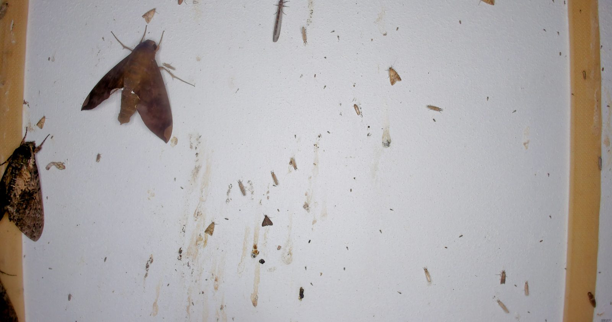
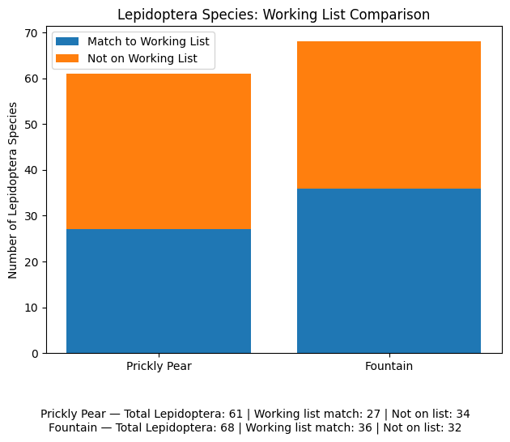
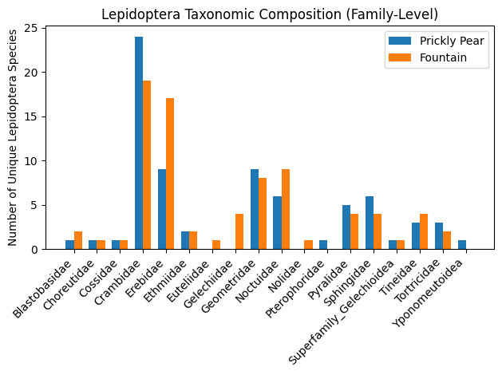

{fig-alt="Monitoring in Anguilla"}

::: {.at-a-glance}
**Status:** in progress · **Region:** Caribbean · **Technology:** [AMI light traps](../../technology/ami.qmd), [LepiSense](../../technology/lepisense.qmd)

**Partners:** Anguilla National Trust, UK Centre for Ecology & Hydrology
:::

## Overview

Insects are essential to how ecosystems work, yet biodiversity data from small island states is critically sparse. With the Anguilla National Trust, we are deploying automated insect monitoring systems across Anguilla to establish a robust baseline of night-time biodiversity.

Using AMI systems with AI image classification and expert checking, we are generating the first standardised, comparable dataset of moth diversity for the island. This lets us go beyond simple species lists to explore how communities differ between sites, which habitats species are linked to, and the outcomes of restoration.

The project brings together:

- **imaging systems (AMI)** to measure the diversity and activity of night-flying moths and butterflies;
- **cloud-based AI** to turn raw photos into checked ecological datasets;
- **expert taxonomic checking**, so species identifications are reliable;
- **habitat and plant data**, to understand plant–insect relationships across sites;
- **local partnership and capacity building**, for long-term monitoring.

## Early findings

Across two monitored sites:

- **88 moth and butterfly species** were found, using automated imaging and expert checking;
- over **40 species were shared between sites**, with strong differences between habitats;
- one site had more plant species, and correspondingly more moth species;
- about **70% of the existing working species list was found**, showing strong coverage of the island's known fauna;
- species-level records were overwhelmingly moths and butterflies, reflecting both how well light traps suit them and how much they dominate night-time insect communities.

These results show that automated monitoring can give meaningful biodiversity insights in small island environments.

::: {layout-ncol=2}
{fig-alt="Bar chart comparing species found with the working list"}

{fig-alt="Chart of species found by family"}
:::

## Outputs

- Species lists for each site.
- Harmonised, checked biodiversity datasets.
- Which species are shared and which are unique to each site.
- Comparisons of plant and moth communities.
- An evaluation of AI-assisted identification.
- Evidence to support long-term monitoring in Anguilla.

[Download the project summary (Word)](anguilla-project-summary.docx){.btn .btn-outline-primary}

## News from Anguilla

- [Anguilla National Trust night hike](../../news/2025-11-25-anguilla-night-hike/index.md)
- [Nature Week talks](../../news/2025-11-25-anguilla-nature-week-talks/index.md)
- [AI, art and nature conservation](../../news/2024-10-29-anguilla-ai-art-and-nature/index.md)

This work is supported by the UK Government's Biodiversity Challenge Funds (Darwin Plus and Darwin Local).
