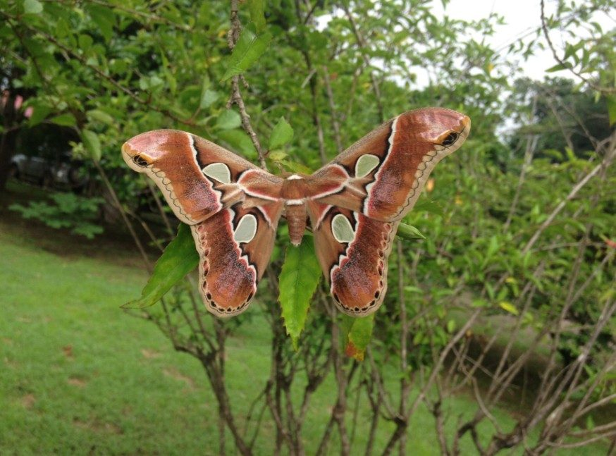

{fig-alt="Monitoring in Costa Rica"}

::: {.at-a-glance}
**Status:** in progress · **Region:** Central America · **Technology:** [AMI light traps](../../technology/ami.qmd), [LepiSense](../../technology/lepisense.qmd)

**Partners:** UK Centre for Ecology & Hydrology, Osa Conservation, Organization for Tropical Studies, and local research partners
:::

## Overview

This project deploys automated imaging systems in Costa Rican forests to measure night-flying insect and pollinator communities along environmental gradients.

## Aims

- Test how imaging systems perform in humid, high-diversity tropical environments.
- Develop robust workflows for data capture, upload and cloud-based classification.
- Link insect communities to habitat type, elevation and land-use change.

## What we're doing

- Installing imaging systems at forest and forest-edge sites.
- Running image models, with experts checking a targeted sample.
- Comparing communities between sites and over time.

The methods developed here will inform our other tropical deployments.

## More from Costa Rica

- [Costa Rica fieldwork diaries](../../diaries/2025-09-05-costa-rica-fieldwork/index.md), with Dr Jenna Lawson
- [Big beautiful moths](../../stories/2025-09-05-amber-big-beautiful-moths/index.md), including the White Witch, one of the world's largest moths
