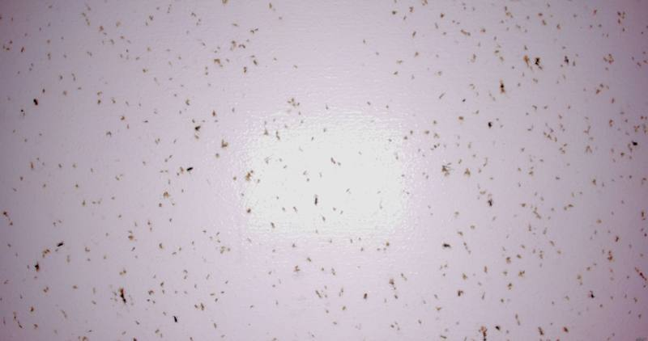

{fig-alt="A trap screen with moths on it"}

::: {.at-a-glance}
**Status:** ongoing, since 2026 · **Where:** dairy farms in England and Wales · **Technology:** [LepiSense](../../technology/lepisense.qmd) light traps, [sound recorders](../../technology/acoustics.qmd) and AI, alongside field surveys

**Partners:** UK Centre for Ecology & Hydrology, working with a UK dairy cooperative and its farmers
:::

## Overview

Many dairy farmers are moving to regenerative farming. But does it make a difference for wildlife? To find out, we're monitoring **pairs of dairy farms**, one regenerative and one conventional in each pair, so that farms in the same area can be compared fairly.

## What we measure

- **Moths**, every night, with LepiSense light traps and AI.
- **Birds and bats**, with sound recorders on each farm.
- **Pollinators and flowers**, plants and hedges, with field surveys.
- **Dung beetles**, which help break down dung and return nutrients to the soil.

Experts check what the AI finds before results are used. We don't name the farms, and the results go first to the farmers and our partner.
