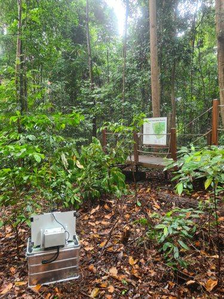

{fig-alt="An automated moth trap set up among plants in Singapore"}

::: {.at-a-glance}
**Status:** in progress (2026 to 2028) · **Where:** starting in the UK, Costa Rica and Singapore · **Technology:** [AMI light traps](../../technology/ami.qmd) and AI

**Partners:** UK Centre for Ecology & Hydrology and the Aberdeen Group Charitable Trust, with local networks and NGOs
:::

## Overview

Insects are declining around the world, and we need better ways to see what is happening to them. **Project INSPIRE** is a three-year partnership between UKCEH and the Aberdeen Group Charitable Trust, which has committed £1 million to the project.

INSPIRE builds on [AMBER](../amber/index.qmd), which showed how AI can help monitor biodiversity. It starts in the UK, Costa Rica and Singapore, where automated insect monitoring systems are already running.

## Two ways of watching insects

- **Insect sensor platforms:** AI-assisted camera systems that monitor night-flying insects, set up and run with local communities.
- **People as sensors:** citizen science, so that anyone can take part in recording insects.

Throughout, the project works with local networks and NGOs so that people from all backgrounds can take part.

> "This partnership represents a transformative step in global biodiversity monitoring for insects."
>
> Professor David Roy, UK Centre for Ecology & Hydrology

## Find out more

- [Partnering with Aberdeen Group Charitable Trust on Project INSPIRE](https://www.ceh.ac.uk/news-and-media/news/partnering-aberdeen-group-charitable-trust-project-inspire) (UKCEH news, January 2026)
- [Where we work](../../map/index.qmd), including our systems in Singapore and Costa Rica
