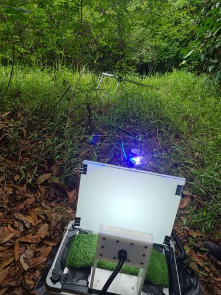
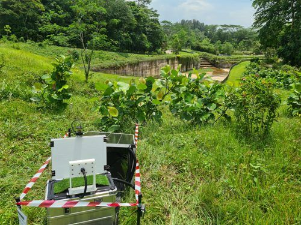
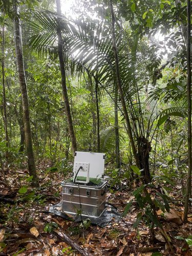
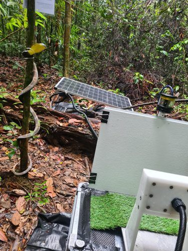

{fig-alt="A light trap glowing on the forest floor at dusk"}

::: {.at-a-glance}
**Status:** ongoing, since 2023 · **Where:** Singapore · **Technology:** [AMI light traps](../../technology/ami.qmd), [sound recorders](../../technology/acoustics.qmd), [bat detectors](../../technology/ultrasonic.qmd) and AI

**Partners:** UK Centre for Ecology & Hydrology, Nanyang Technological University and Gardens by the Bay, supported first by [AMBER](../amber/index.qmd) and now by [INSPIRE](../inspire/index.qmd)
:::

## Overview

Singapore packs rainforest, mangroves, wetlands, parks and gardens into a small, busy island. That makes it a fascinating place to ask how insects, birds and bats get on in and around a city.

Our first system went out in 2023 as part of [AMBER](../amber/index.qmd). Singapore now has **14 systems**, each with a light trap for moths and most with sound recorders for birds and bat detectors too. They've taken more than **3.6 million photos**, and our AI has spotted over **2 million insects** in the photos processed so far.

## What we're doing

- Running systems in a range of habitats, from forest to open, wet ground and gardens.
- Training an AI model for Singapore's moths, with experts checking what it finds.
- Under [INSPIRE](../inspire/index.qmd), working with local partners and communities so that more people can take part.

::: {.gallery}

:::

## More

- [Where we work](../../map/index.qmd#singapore): a few nights from each Singapore system
- [INSPIRE: a new partnership for insects](../../news/2026-01-19-inspire-launch/index.md)
