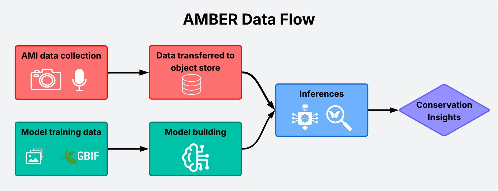
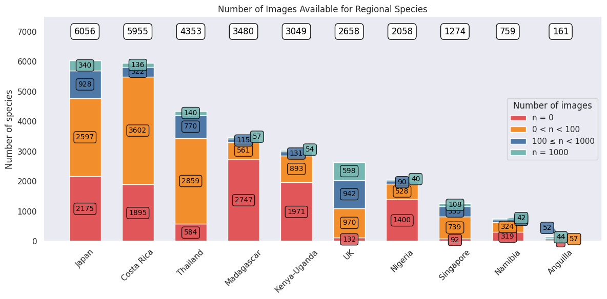
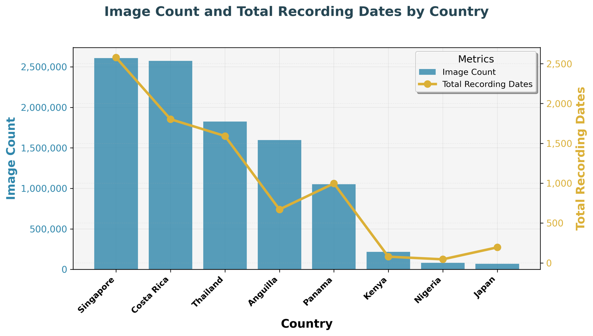
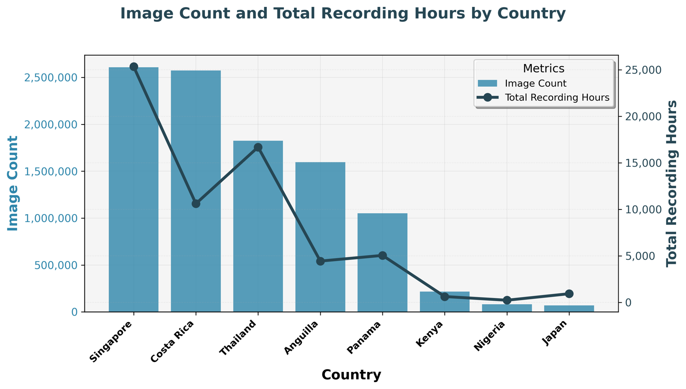
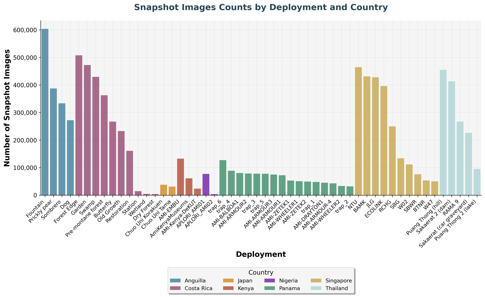
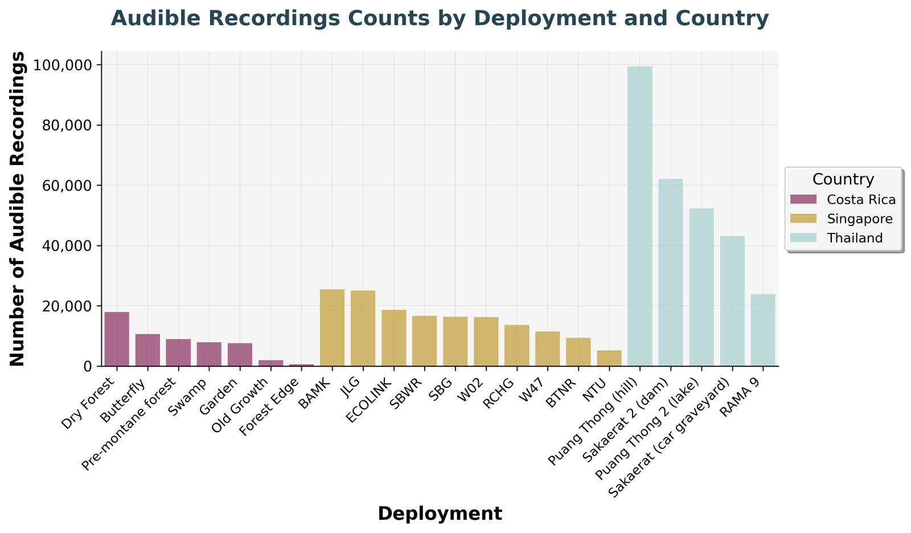
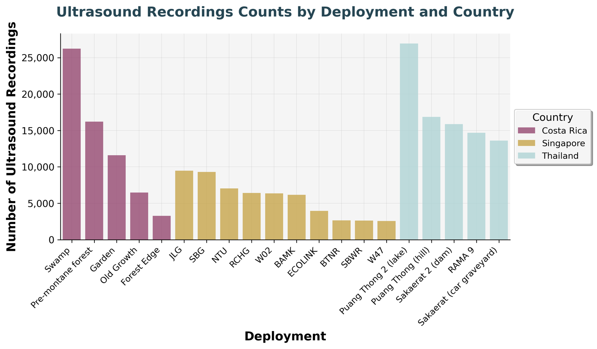
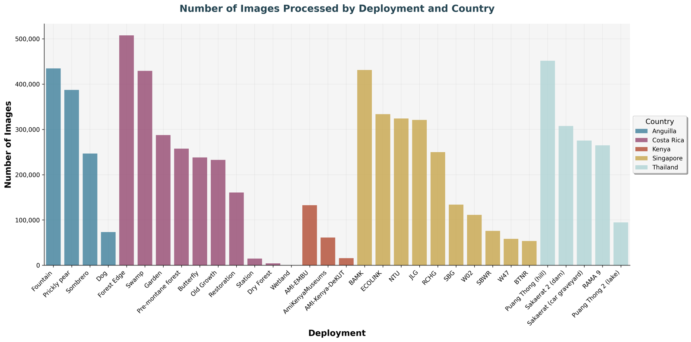
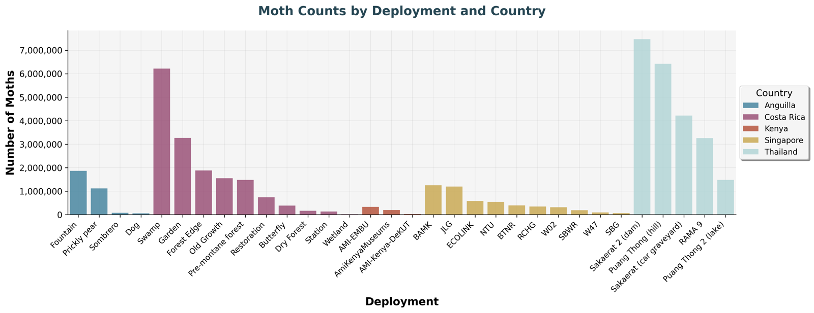
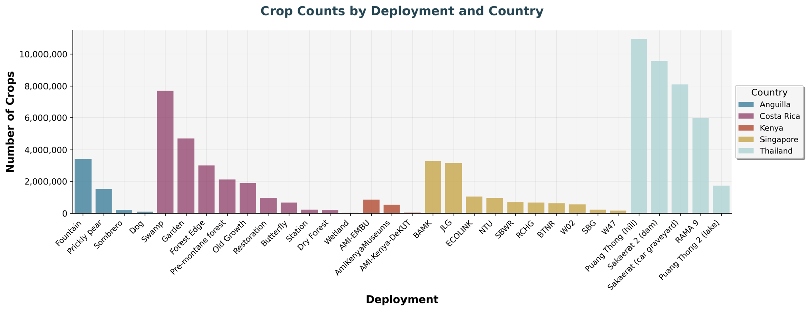

Before diving into technical details, it's worth pausing to appreciate the scale of what we work with in AMBER. The project is building an exceptionally rich biodiversity dataset: millions of images, audio clips and ultrasound recordings that capture the pulse of ecosystems in real time. It's an exciting prospect, but turning these vast data streams into insight takes careful design and perseverance.

## The scale behind the scenes

Behind every ecological insight lie huge volumes of data, from the open-source images used to train our models to the [AMI camera systems](https://www.ceh.ac.uk/solutions/equipment/automated-monitoring-insects-trap) deployed across different environments.

{fig-alt="Flow diagram of the data pipeline"}

Deployment partners upload their image and sound data directly to our object store. From there it goes through processing and curation, ready for large-scale analysis and machine learning. So far AMBER has gathered tens of millions of frames, each a tiny window into an ecosystem, as well as sound and ultrasound recordings.

## Training with GBIF's image armies

Our models learn at scale. Every image, whether nearly identical to another or completely new, makes them more robust, and better at telling moth species apart.

We draw on [GBIF](https://www.gbif.org/) to build training sets. For each deployment country we compile an expert-curated list of species known to occur there, then download all available GBIF images of those species. Ideally we aim for around 1,000 images per species. In less well-documented regions, such as Costa Rica, that target is often out of reach because not enough images have been recorded. These differences show where biodiversity records are strong and where important gaps remain.

In total, almost **2 million images** were downloaded to train the models, one model for each deployment country. The chart shows, for each country, how many species have no images, under 100, under 1,000, or 1,000 or more on GBIF.

{fig-alt="Stacked bar chart of GBIF images per species by country"}

Countries like the UK and Singapore have good coverage for most species, whereas Costa Rica and Madagascar have many species with no images at all. This reflects how much citizen science each region has, and how hard it is to build models that can tell species apart with little or no data.

## Deployment data

Images from AMI deployments show the scale of data we capture ourselves:

::: {.panel-tabset}
## Recording dates
{fig-alt="Images and recording dates by country"}

## Recording hours
{fig-alt="Images and recording hours by country"}
:::

Singapore and Costa Rica lead, as they were among the first to be deployed. Zooming in, we can compare the number of images from each deployment:

{fig-alt="Images per deployment"}

## Sound and ultrasound

Our systems also record sound and ultrasound, which will help us detect birds and bats alongside the photos.

::: {.panel-tabset}
## Audible
{fig-alt="Audible recordings per deployment"}

## Ultrasound
{fig-alt="Ultrasound recordings per deployment"}
:::

Together, these show where data is richest, where systems have run longest, and how each type of sensor adds to the bigger picture.

## Infrastructure to match ambition

Processing imagery at this scale demands serious infrastructure:

- high-performance computing with GPUs, to train deep neural networks and run them;
- distributed storage (object stores) to hold the images;
- efficient pipelines to stream batches, manage metadata and track individuals;
- automated checks that flag problems, such as sudden changes in brightness, unusual mixes of species, or corrupted batches.

Every model version links back to the exact images, settings and parameters used to train it, so results can be reproduced.

## Running the models

The real impact comes when images go through the trained models. By October 2025, almost **7 million images** had been processed, and the number grows daily.

{fig-alt="Images processed per deployment"}

We can go a step further and count the moths, and all the animals ("crops"), found in these images:

::: {.panel-tabset}
## Moths
{fig-alt="Moths found per deployment"}

## All animals found
{fig-alt="Crops found per deployment"}
:::

## When scale becomes strength

What starts as the challenge of "too much data" becomes a strength. With breadth and depth, our models work better across regions and species. Subtle ecological patterns emerge, with the potential to show seasonal changes in behaviour or flag species that matter for conservation. This is the promise of big beautiful data: turning overwhelming complexity into insight that helps us understand, protect and support biodiversity.
